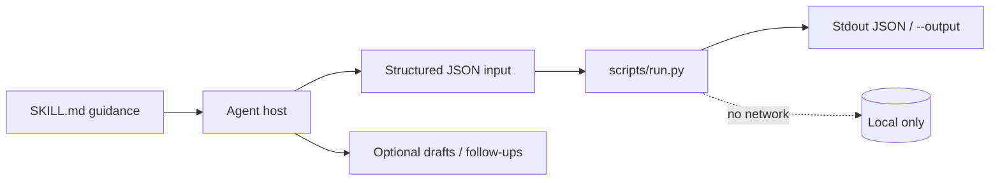
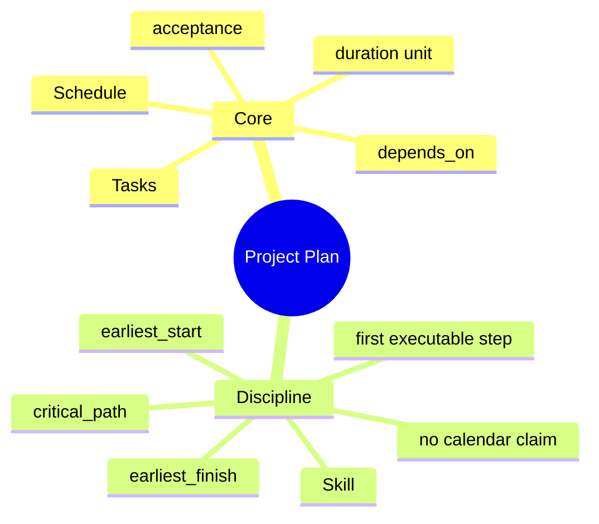

# Project Plan

[English](README.md) · [中文](README.zh-CN.md) · **v0.2.1**

[](https://github.com/KarmenLoop/skill-project-plan/actions/workflows/checks.yml)
[](https://github.com/KarmenLoop/skill-project-plan/releases/latest)
[](https://www.python.org/downloads/)
[](LICENSE)
[](docs/COMPATIBILITY.md)

**See what can start now—and which dependency chain sets the finish—with measurable acceptance checks.**

An agent skill plus a local scheduler over tasks, durations, and dependencies: ordered plan, earliest times, and critical path. You keep the export (or transcript, diff, ledger, event log, or JUnit XML) local; the helper stays on the standard library and never opens a network connection. The skill layer teaches a host *when* to prepare input, *how* to narrate results, and *where* to stop before side effects the user did not authorize.

Built and maintained by [KarmenLoop](https://github.com/KarmenLoop) / [KARMENLOOP](https://karmenloop.com). Current release: **[v0.2.1](https://github.com/KarmenLoop/skill-project-plan/releases/tag/v0.2.1)**. License: **MIT**.


*Actual local output from v0.2.1, rendered as an image. [examples/expected.json](examples/expected.json) · [Image provenance](docs/images/provenance.json).*

[Download v0.2.1](https://github.com/KarmenLoop/skill-project-plan/releases/tag/v0.2.1) · [Tutorial](docs/tutorial.en.md) · [中文教程](docs/tutorial.zh-CN.md) · [Input contract](docs/INPUT.md)

---

## Why this exists

Ad-hoc task lists hide the chain that actually determines delivery. Agents that make a plan often invent staff calendars or promise dates.

This helper computes an earliest-start schedule from **durations and dependencies only**. Cycles and missing IDs fail closed. Unlimited parallel capacity is assumed—and documented.

The skill insists on checkable acceptance statements and a consistent duration unit. Mapping onto real calendars and staffing stays a separate step.

---

## Snapshot

| | |
|---|---|
| **What you install** | Skill tree + `scripts/run.py` planner + `install.py` |
| **Runtime** | Python **3.9+**, standard library only |
| **Network** | **None** |
| **Input** | UTF-8 JSON: `tasks[]` (`id`, `title`, `duration`, `depends_on[]`, `acceptance`, optional `owner`) |
| **Output** | `ordered_tasks` with earliest start/finish, `critical_path`, `estimated_duration` |
| **Install hosts** | `codex` · `deepseek` · `grok` · `agents` |
| **Package id** | `karmen-project-plan` |
| **License** | MIT |

---

## Is / Is not

| Is | Is not |
|---|---|
| Dependency-aware earliest schedule | Resource calendar or staffing optimizer |
| Critical path + estimated duration in one unit | Promised ship date including weekends/PTO |
| Cycle / missing-dependency rejection | Silent repair of broken graphs |
| Offline stdlib helper | Jira / Linear sync |
| Skill that demands measurable acceptance | Authority to implement the whole plan unbidden |

---

## How it works

Two layers stay separate on purpose:

1. **Method layer (`SKILL.md`)** — when to invoke, how to prepare honest input, what to deliver, and which side effects stay forbidden without fresh user authorization.
2. **Deterministic helper (`scripts/run.py`)** — validates a UTF-8 JSON contract (max 10 MiB), computes the result locally, prints JSON to stdout (or a new `--output` file), and exits `2` on invalid input.





### Workflow

1. **Define** the concrete outcome and reuse existing work; avoid unrelated initiatives.
2. **Break** deliverables into unique IDs with positive durations, `depends_on`, and checkable `acceptance`.
3. **Run** the helper. Compare parallel work’s finish against the critical path.
4. **Return** the plan and the first executable step. Implement or delegate only when the current request authorizes that work.

### What the sample proves

Three dependent tasks finish at offsets 1, 4, and 6. Critical path `a → b → c`, `estimated_duration` 6.

Exit `0` means processing finished—not that every business finding “passed.”

---

## Quickstart

Download `karmen-project-plan-v0.2.1.zip` and its `.sha256` from the [v0.2.1 release](https://github.com/KarmenLoop/skill-project-plan/releases/tag/v0.2.1), verify the hash, and extract. Requires Python 3.9+.

```sh
python3 scripts/run.py --version
python3 scripts/run.py --input examples/input.json
```

Expected version string: `karmen-project-plan 0.2.1`.

Optional: install into a host that scans a skills directory (installer refuses an existing destination):

```sh
python3 install.py --host agents
# also: --host codex | deepseek | grok
# or:  --destination /exact/new/directory
```

You can run the helper with no AI host at all. Host discovery and invocation still vary—see [docs/tutorial.en.md](docs/tutorial.en.md) and [docs/COMPATIBILITY.md](docs/COMPATIBILITY.md).

Pipe mode and version probe:

```sh
python3 scripts/run.py --input - < examples/input.json
python3 scripts/run.py --version
```

---

## Use it with your own work

Read [docs/INPUT.md](docs/INPUT.md) before shaping a new payload.

- Keep duration units consistent across the file.
- Try a missing dependency and a cycle—both should reject before scheduling.
- Owner is optional; do not invent staff.
- Critical path ignores weekends and people’s availability.

The helper needs no model account, API key, or network. An AI host has its own data and permission settings; this skill adds no authority to send, purchase, publish, or change access.

---

## Documentation map

| Doc | Use it when you need… |
|---|---|
| [Tutorial (EN)](docs/tutorial.en.md) · [中文](docs/tutorial.zh-CN.md) | Download, install, practice, upgrade, remove |
| [Input / output contract](docs/INPUT.md) · [中文](docs/input.zh-CN.md) | Field semantics and examples |
| [Compatibility](docs/COMPATIBILITY.md) | Host install paths and unverified boundaries |
| [Validation](docs/VALIDATION.md) | What was actually exercised |
| [Sources](docs/SOURCES.md) | Research notes behind the design |
| [Changelog](CHANGELOG.md) | Release history |
| [Contributing](CONTRIBUTING.md) · [Support](SUPPORT.md) · [Security](SECURITY.md) | Collaboration and reports |

---

## Validation (honest)

Observed baseline (see [docs/VALIDATION.md](docs/VALIDATION.md)): 2026-10-18 (UTC) · Python 3.9.6 · macOS arm64 (see docs/VALIDATION.md).

| Check | Result |
|---|---|
| `python3 scripts/run.py --input examples/input.json` | Exit 0; fixture aligned with live output |
| `python3 -m unittest discover -s tests -v` | Exit 0 on maintainer run |
| `skill-creator` quick validate | Metadata accepted |

**Not claimed:** authenticated conversations inside every supported host, live account connectors, or native Windows/Linux host UI coverage. Installation is tested in temporary directories; model interpretation remains a host responsibility. Confirm the exact `SKILL.md` is discovered before relying on invocation.

CI: [`.github/workflows/checks.yml`](https://github.com/KarmenLoop/skill-project-plan/actions/workflows/checks.yml).

---

## FAQ

### What is Project Plan, in one sentence?

An MIT skill and offline helper that turns tasks, durations, and dependencies into an ordered earliest schedule with a critical path.

### Does the critical path include weekends or availability?

No. Durations and dependencies only. Map to real calendars separately.

### Are estimates delivery promises?

No. They are assumptions under unlimited parallel capacity.

### Where does output go?

Stdout or new `--output`; existing files preserved.

### Install?

`python3 install.py --host agents` (also `codex` / `deepseek` / `grok`).

### Will it create tickets in my tracker?

Not by itself. Creating tasks requires explicit user authorization in the host.

---

## License and contact

[MIT](LICENSE) · Keep the license and [notice](NOTICE.md) with redistributed copies.

[karmenloop.com](https://karmenloop.com) · [GitHub @KarmenLoop](https://github.com/KarmenLoop) · [info@karmenloop.com](mailto:info@karmenloop.com)

KARMENLOOP Official Team · Shanghai

<!-- Copyright (C) 2026 KARMENLOOP Official Team
SPDX-License-Identifier: MIT -->
