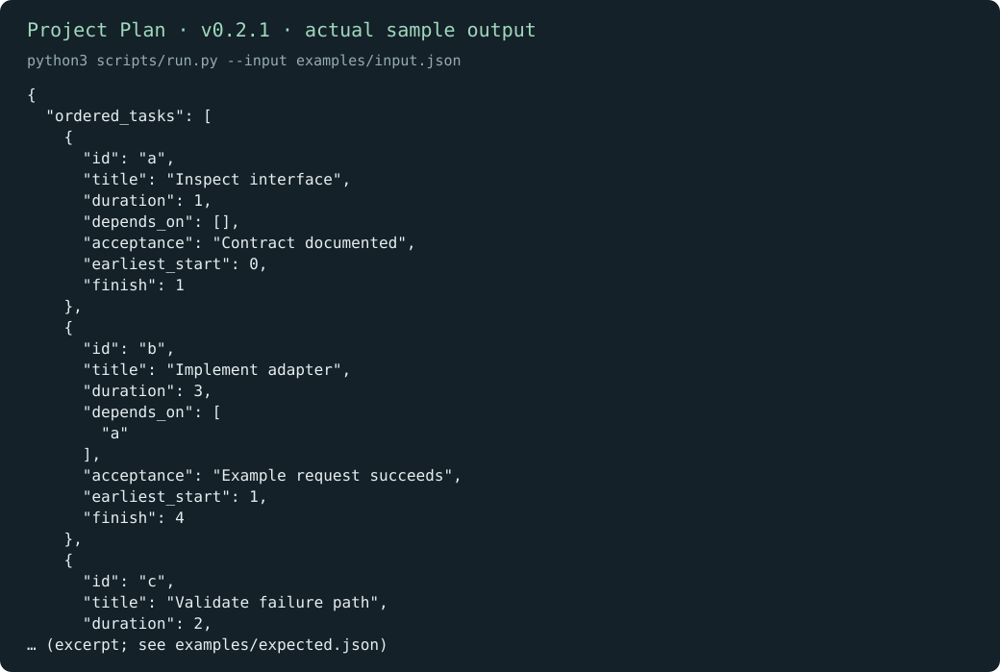
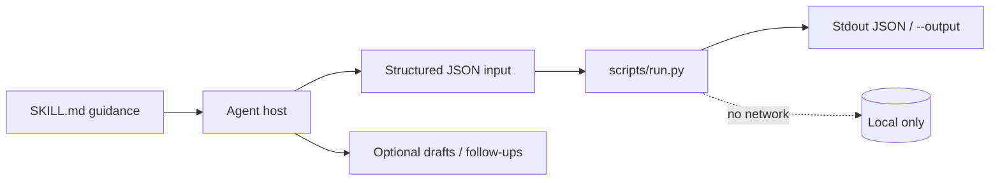
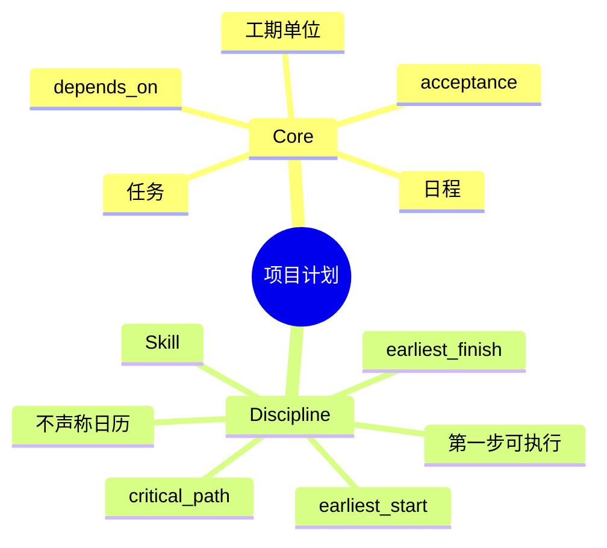

# 项目计划

[English](README.md) · [中文](README.zh-CN.md) · **v0.2.1**

[](https://github.com/KarmenLoop/skill-project-plan/actions/workflows/checks.yml)
[](https://github.com/KarmenLoop/skill-project-plan/releases/latest)
[](https://www.python.org/downloads/)
[](LICENSE)
[](docs/COMPATIBILITY.md)

**看清现在能开工什么，以及哪条依赖链决定完工——每项都带可度量验收。**

一套 Agent Skill，外加本地调度器：基于任务、工期与依赖，给出有序计划、最早时间与关键路径。 导出（或会议文本、diff、账本、事件日志、JUnit XML）留在本地；辅助程序只用标准库，从不发起网络连接。Skill 层教宿主*何时*准备输入、*如何*陈述结果，以及在用户未授权的副作用前*停在哪里*。

由 [KarmenLoop](https://github.com/KarmenLoop) / [KARMENLOOP](https://karmenloop.com) 维护。当前发布：**[v0.2.1](https://github.com/KarmenLoop/skill-project-plan/releases/tag/v0.2.1)**。许可证：**MIT**。



*v0.2.1 真实本地输出渲染图。[examples/expected.json](examples/expected.json) · [图像出处](docs/images/provenance.json)。*

[下载 v0.2.1](https://github.com/KarmenLoop/skill-project-plan/releases/tag/v0.2.1) · [英文教程](docs/tutorial.en.md) · [中文教程](docs/tutorial.zh-CN.md) · [输入契约](docs/input.zh-CN.md)

---

## 为什么做这个

临时任务清单会掩盖真正决定交付的那条链。爱「做计划」的 Agent 常编造人员日历或承诺日期。

本辅助程序仅根据**工期与依赖**计算最早开始日程。环路与缺失 ID 会失败关闭。并行能力假设无限——并写在文档里。

Skill 要求可检查的验收陈述与一致的工期单位。映射到真实日历与人力是另一步。

---

## 快照

| | |
|---|---|
| **安装内容** | Skill 树 + `scripts/run.py` 规划器 + `install.py` |
| **运行时** | Python **3.9+**，仅标准库 |
| **网络** | **无** |
| **输入** | UTF-8 JSON：`tasks[]`（`id`、`title`、`duration`、`depends_on[]`、`acceptance`，可选 `owner`） |
| **输出** | 含最早起止的 `ordered_tasks`、`critical_path`、`estimated_duration` |
| **安装宿主** | `codex` · `deepseek` · `grok` · `agents` |
| **包标识** | `karmen-project-plan` |
| **许可证** | MIT |

---

## 是 / 不是

| 是 | 不是 |
|---|---|
| 感知依赖的最早日程 | 资源日历或人力优化器 |
| 关键路径 + 单一单位下的估计工期 | 含周末/休假的承诺交付日 |
| 环路 / 缺失依赖直接拒绝 | 静默修补坏图 |
| 离线标准库辅助程序 | Jira / Linear 同步 |
| 要求可度量验收的 Skill | 未经请求就实施整份计划的权限 |

---

## 工作方式

两层有意分开：

1. **方法层（`SKILL.md`）** — 何时调用、如何准备诚实输入、交付什么，以及哪些副作用在没有新的用户授权时仍禁止。
2. **确定性辅助程序（`scripts/run.py`）** — 校验 UTF-8 JSON 契约（最大 10 MiB），本地计算，打印到 stdout（或新的 `--output`），非法输入以 `2` 退出。





### 流程

1. **定义**具体结果并复用已有工作；避免塞入无关事项。
2. **拆解**为带唯一 ID、正工期、`depends_on` 与可检查 `acceptance` 的交付项。
3. **运行**辅助程序。把并行工作的完工时间与关键路径对照。
4. **返回**计划与第一个可执行步骤。仅在当前请求授权时实施或委派。

### 示例证明什么

三个依赖任务分别在偏移 1、4、6 完工。关键路径 `a → b → c`，`estimated_duration` 为 6。

退出码 `0` 表示处理完成——不表示业务上「全部通过」。

---

## 快速开始

从 [v0.2.1 发布页](https://github.com/KarmenLoop/skill-project-plan/releases/tag/v0.2.1) 下载 `karmen-project-plan-v0.2.1.zip` 与对应 `.sha256`，校验哈希后解压。需要 Python 3.9+。

```sh
python3 scripts/run.py --version
python3 scripts/run.py --input examples/input.json
```

期望版本串：`karmen-project-plan 0.2.1`。

可选：安装到会扫描 skills 目录的宿主（目标已存在则拒绝）：

```sh
python3 install.py --host agents
# 亦可：--host codex | deepseek | grok
# 或：  --destination /精确/新目录
```

完全可以不借助 AI 宿主直接跑辅助程序。宿主发现与调用方式仍因产品而异——见 [docs/tutorial.zh-CN.md](docs/tutorial.zh-CN.md) 与 [docs/COMPATIBILITY.md](docs/COMPATIBILITY.md)。

管道与版本探测：

```sh
python3 scripts/run.py --input - < examples/input.json
python3 scripts/run.py --version
```

---

## 用在你自己的工作上

准备新载荷前先读 [docs/input.zh-CN.md](docs/input.zh-CN.md)（或 [docs/INPUT.md](docs/INPUT.md)）。

- 全文件保持工期单位一致。
- 试缺失依赖与环路——二者都应在排程前拒绝。
- owner 可选；不要编造人员。
- 关键路径不考虑周末与人员可用性。

辅助程序不需要模型账号、API 密钥或网络。AI 宿主有自己的数据与权限设置；本 skill 不授予发送、购买、发布或改权限的权力。

---

## 文档地图

| 文档 | 何时使用 |
|---|---|
| [教程（中文）](docs/tutorial.zh-CN.md) · [English](docs/tutorial.en.md) | 下载、安装、练习、升级、卸载 |
| [输入/输出契约（中文）](docs/input.zh-CN.md) · [EN](docs/INPUT.md) | 字段语义与示例 |
| [兼容性](docs/COMPATIBILITY.md) | 宿主安装路径与未验证边界 |
| [验证](docs/VALIDATION.md) | 实际跑过什么 |
| [来源](docs/SOURCES.md) | 设计背后的研究笔记 |
| [变更日志](CHANGELOG.md) | 发布历史 |
| [贡献](CONTRIBUTING.md) · [支持](SUPPORT.md) · [安全](SECURITY.md) | 协作与报告 |

---

## 验证（如实）

基线见 [docs/VALIDATION.md](docs/VALIDATION.md)：2026-10-18 (UTC) · Python 3.9.6 · macOS arm64 (see docs/VALIDATION.md)。

| 检查 | 结果 |
|---|---|
| `python3 scripts/run.py --input examples/input.json` | 退出 0；夹具与实跑输出对齐 |
| `python3 -m unittest discover -s tests -v` | 维护者环境退出 0 |
| `skill-creator` 快速校验 | 元数据通过 |

**未声称：** 每个支持宿主内的已登录对话、在线账号连接器，或 Windows/Linux 宿主 UI 全覆盖。安装在临时目录测过；模型如何解释仍是宿主责任。依赖调用前请确认精确的 `SKILL.md` 已被发现。

CI：[`.github/workflows/checks.yml`](https://github.com/KarmenLoop/skill-project-plan/actions/workflows/checks.yml)。

---

## 常见问题

### 一句话：项目计划是什么？

MIT Skill + 离线辅助程序：把任务、工期与依赖变成带关键路径的有序最早日程。

### 关键路径含周末或人员可用性吗？

不含。只有工期与依赖。映射真实日历需另做。

### 估计是交付承诺吗？

不是。是在无限并行假设下的假定。

### 输出到哪？

stdout 或新的 `--output`；保留已有文件。

### 如何安装？

`python3 install.py --host agents`（也支持 `codex` / `deepseek` / `grok`）。

### 会在看板建单吗？

不会自行建。宿主中创建任务需要用户明确授权。

---

## 许可与联系

[MIT](LICENSE)。再分发时请保留许可证与 [声明](NOTICE.md)。

[karmenloop.com](https://karmenloop.com) · [GitHub @KarmenLoop](https://github.com/KarmenLoop) · [info@karmenloop.com](mailto:info@karmenloop.com)

KARMENLOOP Official Team · 上海

<!-- Copyright (C) 2026 KARMENLOOP Official Team
SPDX-License-Identifier: MIT -->
